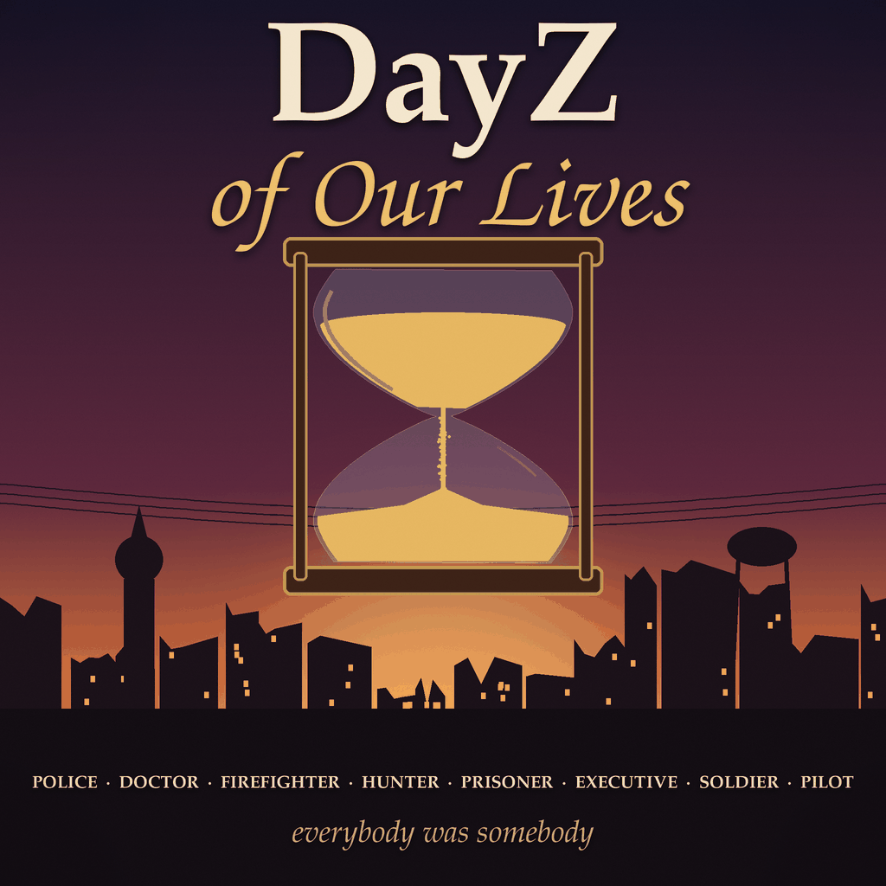

# DayZ of Our Lives



Everybody was somebody. A DayZ server mod: every new character spawns as one of 22 roles -
police officer, doctor, firefighter, executive, prisoner... - dressed in the matching vanilla
outfit with a few things that fit the job, and told who they are ("You are a Firefighter").
Everything is vanilla clothing and items.

**Server-side only:** players don't download anything.

## The roles

| Role | Wears | Carries (some of it) |
|---|---|---|
| Police officer | PoliceCap, PoliceJacket, PolicePants... | Flashlight, Handcuffs, HandcuffKeys |
| Doctor | MedicalScrubsHat_White, LabCoat, MedicalScrubsPants_White... | FirstAidKit, SalineBagIV, BloodTestKit |
| Nurse | MedicalScrubsHat_White, NurseDress_White, DressShoes_White... | FirstAidKit, SalineBagIV, PainkillerTablets |
| Paramedic | MedicalScrubsHat_Blue, ParamedicJacket_Blue, ParamedicPants_Blue... | FirstAidKit, SalineBagIV, SalineBagIV |
| Soldier | Ssh68Helmet, TTsKOJacket_Camo, TTSKOPants... | TacticalBaconCan, TacticalBaconCan, Compass |
| Technician | BaseballCap_Black, JumpsuitJacket_Blue, JumpsuitPants_Blue... | Screwdriver, Pliers, DuctTape |
| Hunter | BoonieHat_Olive, HuntingJacket_Autumn, HunterPants_Autumn... | HuntingKnife, Matchbox, Rope |
| Motorcyclist | MotoHelmet_Black, RidersJacket_Black, Jeans_Black... | LugWrench, SparkPlug, Roadflare |
| Firefighter | FirefightersHelmet_Red, FirefighterJacket_Beige, FirefightersPants_Beige... | FirefighterAxe, Roadflare, Rope |
| Lumberjack | BeanieHat_Red, Shirt_RedCheck, Jeans_Blue... | WoodAxe, Matchbox, Whetstone |
| Prisoner | PrisonerCap, PrisonUniformJacket, PrisonUniformPants... | Lockpick, Rag, SpaghettiCan |
| Journalist | PressVest_Blue, Shirt_WhiteCheck, SlacksPants_Khaki... | Binoculars, PersonalRadio, Paper |
| Athlete | BaseballCap_Red, TrackSuitJacket_Black, TrackSuitPants_Black... | WaterBottle, Apple, Apple |
| Executive | ManSuit_Black, SlacksPants_Black, DressShoes_Black... | ScientificBriefcase, PersonalRadio |
| NBC specialist | NBCHoodGray, NBCJacketGray, NBCPantsGray... | GasMask_Filter, GasMask_Filter, PurificationTablets |
| Tradesman | ConstructionHelmet_Yellow, Sweater_Gray, Jeans_Blue... | Hammer, NailBox, HandSaw |
| Medieval re-enactor | GreatHelm, Chainmail, Chainmail_Leggings... | Sword, Whetstone, Canteen |
| Sniper | GhillieHood_Woodland, GorkaEJacket_Summer, GorkaPants_Summer... | Rangefinder, WeaponCleaningKit, TacticalBaconCan |
| Tank crew | TankerHelmet, GorkaEJacket_Flat, GorkaPants_Flat... | LugWrench, Wrench, Rag |
| Military police | MilitaryBeret_Red, BDUJacket, BDUPants... | Flashlight, Handcuffs, HandcuffKeys |
| Pilot | ZSh3PilotHelmet, PilotJacket_Black, CargoPants_Green... | ChernarusMap, Compass, Roadflare |
| Hiker | SherpaHat_Red, HikingJacket_Red, CargoPants_Blue... | ChernarusMap, Compass, WaterBottle |

"A|B" in the file means either, picked at random, so two police officers rarely look alike.
After the role's kit, the mission's own starting items (vanilla: a bandage, a chemlight and
some fruit) still go in.

## For server owners

1. Put the mod in the server folder as `@DayZOfOurLives`.
2. Load it as a server mod: `-serverMod=@DayZOfOurLives` (not `-mod=`: players don't need it).
3. Start the server once. It writes the default roles to `profiles/DayZOfOurLives/Roles.json`;
   edit that and restart to change them.

Works with any map and mission that uses the vanilla character creation. It does nothing if
your `cfggameplay.json` sets spawn gear presets (`spawnGearPresetFiles`), which take over the
same job, or if your mission's `init.c` overrides `EquipCharacter` itself.

### Roles.json

```json
{
  "roles": [
    {
      "name": "Police officer",
      "weight": 1,
      "clothing": ["PoliceCap", "PoliceJacket|PoliceJacketOrel", "PolicePants|PolicePantsOrel"],
      "items": [
        {"type": "Flashlight", "hands": true, "attachments": ["Battery9V"], "cargo": []},
        {"type": "Handcuffs", "hands": false, "attachments": [], "cargo": []}
      ]
    }
  ]
}
```

- `weight`: how often the role comes up relative to the others (all 1 by default).
- `clothing`: worn, in this order (a backpack's cargo is room for the items).
- `items`: `hands` puts it in the player's hands; `attachments` and `cargo` go on and in it.
- Any class name can be `"A|B|C"`, one picked at random.

If the file can't be read, players spawn the vanilla way and the server log says why.

## Layout

| Path | What |
|---|---|
| `DayZOfOurLives/` | The mod (PBO prefix `DayZOfOurLives`): config, scripts, the default `Roles.json` |
| `DayZOfOurLives/Scripts/5_Mission/DayZOfOurLives/` | `DOOL_Roles.c` (loading, picking, dressing, a validator), `DOOL_MissionServer.c` (the hook into character creation) |
| `mission/` | Test mission on Chernarus |
| `tools/make_preview.py` | Draws the Workshop picture |
| `CHANGELOG.md` | One entry per release; the entry is also the Workshop change note |

## Testing

`mission/` is linked into DayZMissions as `missions/dayzofourlives.chernarusplus`, and
DayZMissions `mods/DayZOfOurLives` is a symlink to `DayZOfOurLives/` here. From DayZMissions,
`tools/test.sh dayzofourlives` boots a headless server with the mod loaded server-side; the
mission checks every class name, attachment and cargo slot, that the weighted pick reaches every
role, and dresses a test survivor as each role, then shuts down (`[DOOLTest]` lines).
`tools/run_server.sh dayzofourlives` starts it for real.

## Releasing

1. Add the version's entry to `CHANGELOG.md`, commit, tag and push:

   ```sh
   git tag -a v0.1 -m "DayZ of Our Lives 0.1"
   git push origin main v0.1
   ```

2. From DayZMissions, upload it yourself (SteamCMD asks for the password and a Steam Guard
   code; it knocks the desktop Steam client offline, so don't publish while playing). The first
   time, run it twice: the first run creates the item and records its id, the second uploads
   the mod with that id in its `meta.cpp`.

   ```sh
   tools/workshop_publish.sh DayZOfOurLives <steam login>
   ```

   Title, tags (`Mod Server Character Equipment`) and description come from the mod's
   `workshop.*` files; the version's `CHANGELOG.md` entry becomes the change note.
